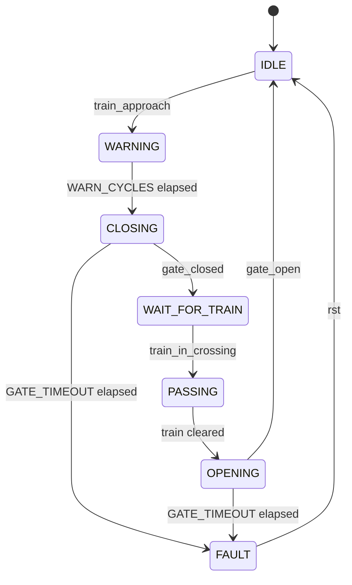
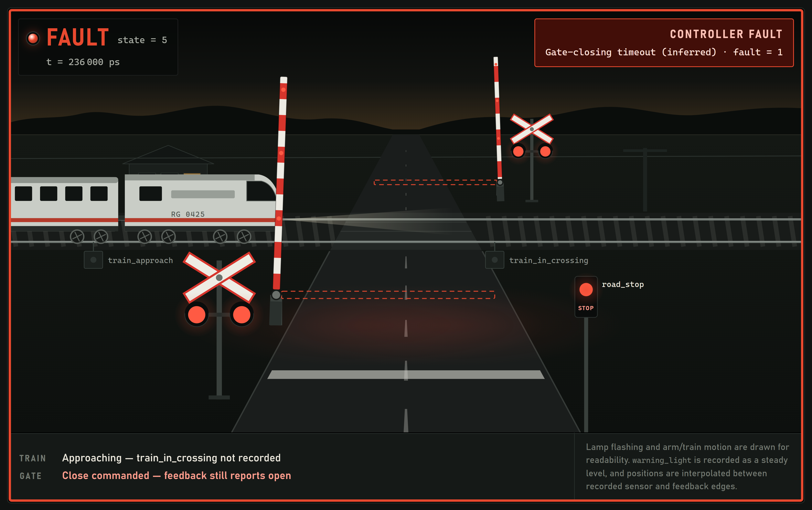

# RAILGUARD

A railway level-crossing controller in Verilog, verified by a self-checking
SystemVerilog testbench, and replayed in the browser from the simulation's own
recorded trace.


| Path | What it is |
|---|---|
| `rtl/design.sv` | The controller. Synthesisable Verilog-2001, one Moore FSM. |
| `rtl/testbench.sv` | Self-checking: 10 directed checks + an immediate-assertion monitor. |
| `data/railguard_trace.csv` | The trace this testbench produced. 42 samples, 6 000–416 000 ps. |
| everything else | The replay tool. Zero dependencies, no build step. |

---

## The controller

A level crossing has one job it must never get wrong: **the barrier must be
confirmed down before the train is allowed over the road.**



`WAIT_FOR_TRAIN` is what makes that guarantee hold. Without it, `CLOSING` would
hand straight to `PASSING`, and the controller would be relying on the train
arriving *after* the barrier finished moving — a race, not a guarantee. Instead
the two conditions are separated: leave `CLOSING` only when `gate_closed` says
the barrier is down, and leave `WAIT_FOR_TRAIN` only when `train_in_crossing`
says the train has arrived. The crossing simply waits, closed, for as long as it
takes.

That rests on keeping two kinds of signal apart, which the design and the UI both
do:

| Kind | Signals | Meaning |
|---|---|---|
| **Command** (output) | `gate_close_cmd`, `gate_open_cmd` | what the controller is *asking* for |
| **Feedback** (input) | `gate_closed`, `gate_open` | what the barrier *reports* it did |

The FSM never advances on a command. It advances on feedback, or it times out
into `FAULT`. Asking a barrier to close is not evidence that it closed.

| State | `warning_light` | `road_stop` | `gate_close_cmd` | `gate_open_cmd` | `fault` |
|---|:--:|:--:|:--:|:--:|:--:|
| `IDLE` (0) | 0 | 0 | 0 | 1 | 0 |
| `WARNING` (1) | 1 | 1 | 0 | 1 | 0 |
| `CLOSING` (2) | 1 | 1 | 1 | 0 | 0 |
| `WAIT_FOR_TRAIN` (6) | 1 | 1 | 1 | 0 | 0 |
| `PASSING` (3) | 1 | 1 | 1 | 0 | 0 |
| `OPENING` (4) | 1 | 1 | 0 | 1 | 0 |
| `FAULT` (5) | 1 | 1 | 1 | 0 | 1 |

Reset is asynchronous. `FAULT` is absorbing — only `rst` leaves it, and it leaves
the barrier commanded closed and the road stopped. Failing safe means failing
*closed*. Parameters: `WARN_CYCLES = 3`, `GATE_TIMEOUT = 5`; 10 ns clock,
`timescale 1ns/1ps`.

---

## Verification

Ten directed checks compare the full output vector against the specification at
each key moment (`ALL TESTS PASSED`, 0 errors), and an assertion monitor on every
negative clock edge re-checks the outputs for whatever state the FSM is in,
calling `$fatal` on the first mismatch. The directed checks say the right things
happened at the right moments; the monitor says nothing wrong happened in
between.

These are directed tests over the listed scenarios, not exhaustive verification.

```sh
cd rtl
iverilog -Wall -g2012 -o a.out design.sv testbench.sv && vvp a.out
```

`-g2012` is required — the monitor uses SystemVerilog immediate assertions. The
same command works on [EDA Playground](https://edaplayground.com) with Icarus
Verilog 12.0 and *SystemVerilog* as the testbench language.

The run writes `railguard_trace.csv`. Copy it over `data/railguard_trace.csv` to
replay a fresh run, and update `src/data/verification.js` to match the new
transcript.

---

## The trace

One row per `posedge clk`, written by the testbench once values have settled:

```
time_ps,state,train_approach,train_in_crossing,gate_closed,gate_open,warning_light,road_stop,gate_close_cmd,gate_open_cmd,fault
```

`state` is `0` IDLE · `1` WARNING · `2` CLOSING · `3` PASSING · `4` OPENING ·
`5` FAULT · `6` WAIT_FOR_TRAIN. The bundled run covers three scenarios back to
back:

| # | Scenario | Window | Ends in |
|---|---|---|---|
| 1 | **Normal crossing** | 6 000 – 146 000 ps | `IDLE` — full cycle completed |
| 2 | **Gate-closing failure** | 156 000 – 266 000 ps | `FAULT` at 236 000 ps, reset at 246 000 ps |
| 3 | **Gate-opening failure** | 266 000 – 416 000 ps | `FAULT` at 416 000 ps |

The app plays one at a time, because replaying all three as one animation looks
like a single train teleporting back to the start twice. The boundaries are
**inferred** from the recorded state path — the CSV has no scenario, `rst` or
timer column — and the UI labels them as inferred.

---

## The replay tool

Node.js 16 or newer, nothing to install:

```sh
node server.js      # then open http://localhost:5173/
```

On Windows, double-click `start.bat`. Port busy? `node server.js 8080`. Opening
`index.html` straight from disk will not work — browsers block ES modules on
`file://` pages.

Play with `Space`, step samples with `←` `→`, jump between events with
`Shift + ←/→`, reach the next fault with `F`, seek by dragging the timeline or
clicking the waveform, and switch scenario from the bar above the scene. *Import
CSV* or drag a `.csv` onto the page to load a different trace; malformed files
are rejected with line-numbered reasons and the previous trace stays loaded.

Everything is recomputed from the trace at the current timestamp, so playback is
deterministic — seeking backwards rebuilds the scene from scratch.

When command and feedback disagree the scene draws the disagreement: a dashed
ghost arm marks where the controller is *asking* the barrier to be, while the
solid arm stays where the feedback bits place it.



Alongside the scene, telemetry shows the current row signal by signal with
sensors, feedback and commands grouped apart; the event log lists every recorded
transition and edge in the current scenario; and the fault diagnosis is derived
from the rows themselves — which state the controller fell out of, which command
was asserted and when, which feedback never came, and how long it waited.


---

## What this is not

- It does **not** run the Verilog, and does **not** control anything.
- The verification panel reports the **testbench's** results; it does not
  recompute them from the CSV, and 10/10 directed checks is not a safety case.
- Train position, barrier angle and lamp flashing are **drawn for readability**.
  The trace records levels and edges, not positions. Telemetry always shows the
  true recorded values.
- Scenario boundaries, the reset at 246 000 ps and the timeout classifications
  are **inferred** from the state path. The UI marks every one of them as such.

---

Built for **ECL 303 — Hardware Description Languages**.
