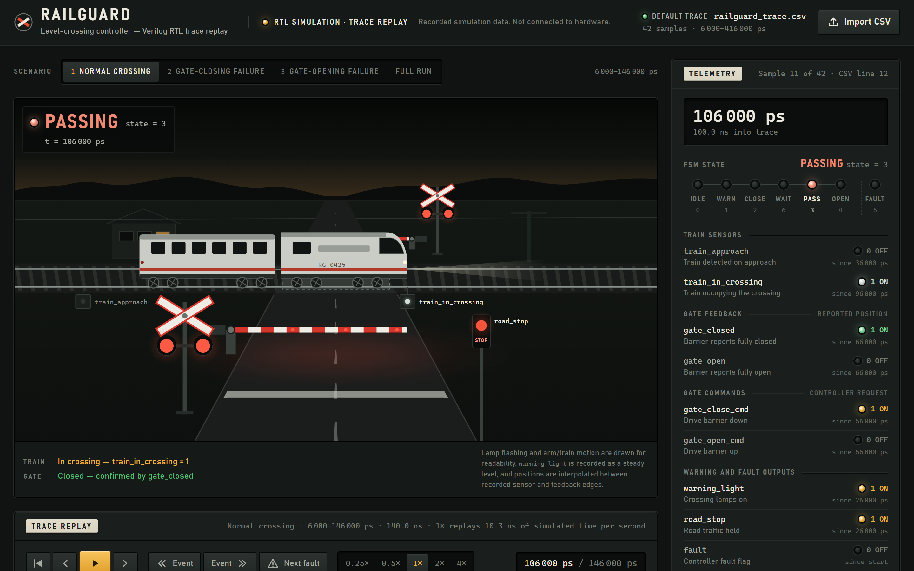
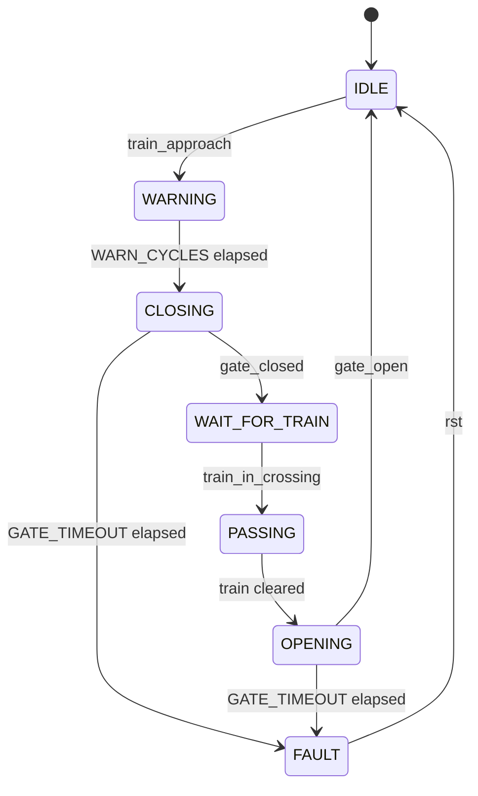
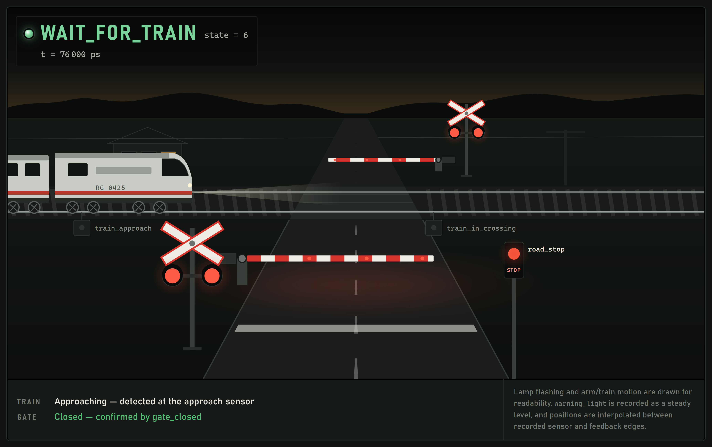
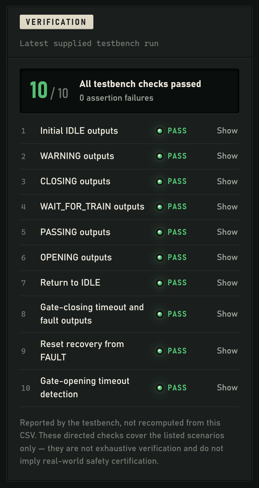
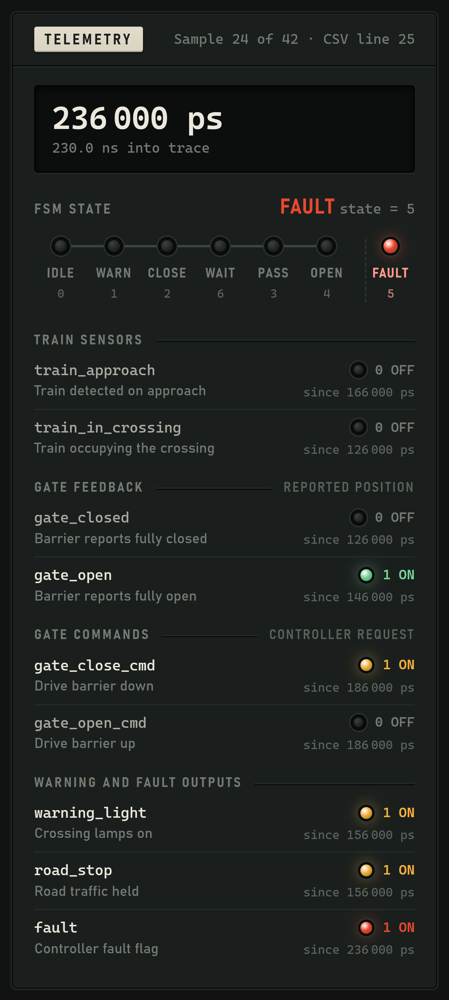
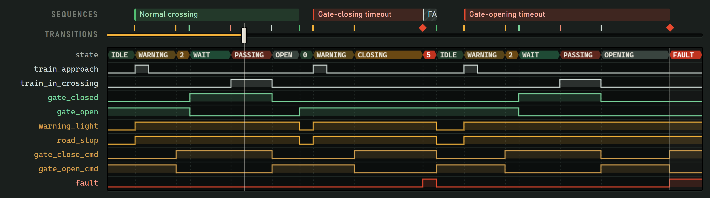
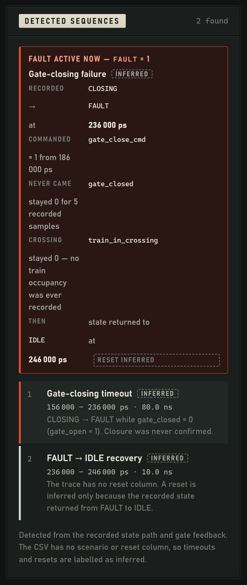
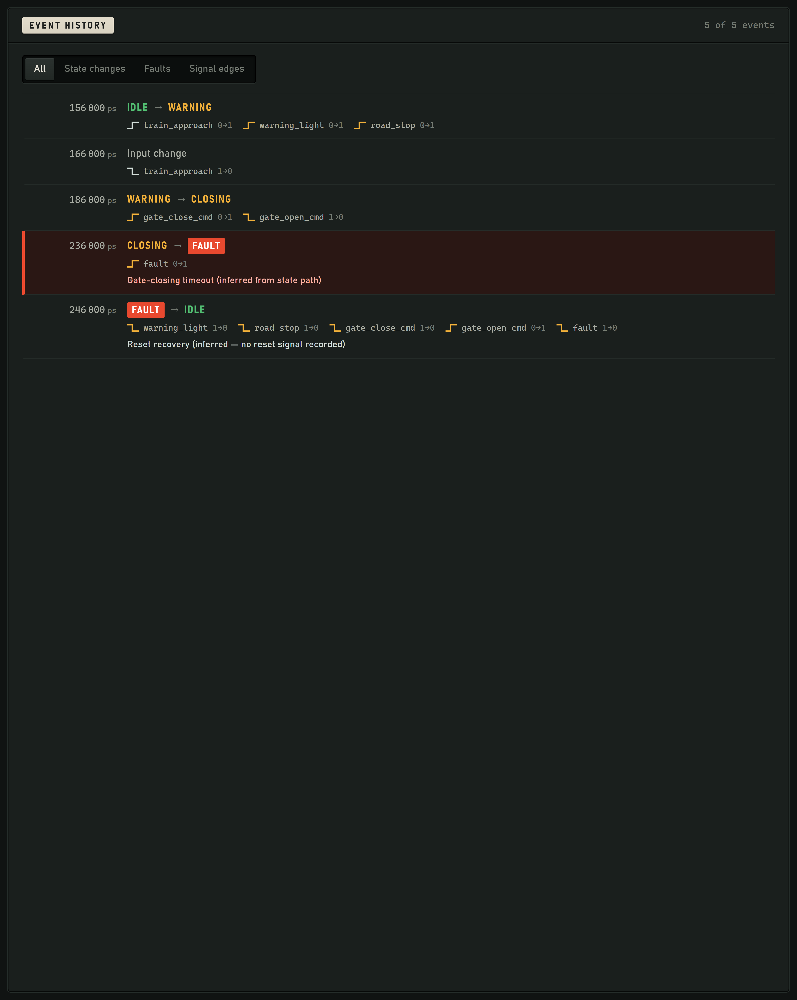
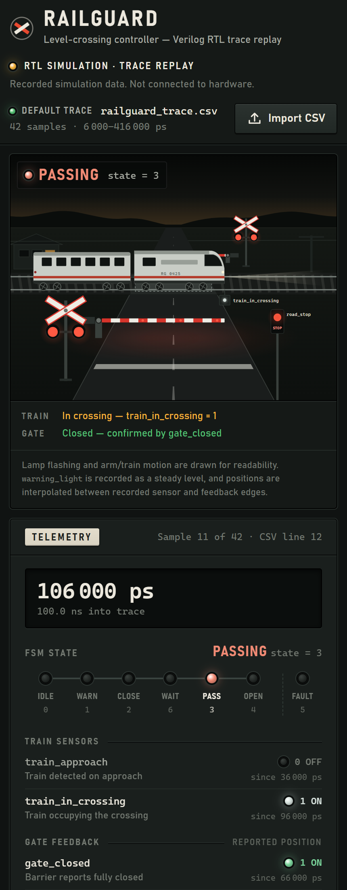

# RAILGUARD

A railway level-crossing controller written in Verilog, verified with a
self-checking SystemVerilog testbench, and replayed in the browser from the
simulation's own recorded trace.

The controller is the project. The web app is an instrument for reading what the
controller actually did — every pixel on screen is driven by a row of the CSV the
testbench wrote.



---

## Contents

| Path | What it is |
|---|---|
| `rtl/design.sv` | The controller. Synthesisable Verilog-2001, one Moore FSM. |
| `rtl/testbench.sv` | Self-checking testbench: 10 directed checks + immediate assertions. |
| `data/railguard_trace.csv` | The trace this exact testbench produced. 42 samples, 6 000–416 000 ps. |
| everything else | The browser replay tool. Zero dependencies, no build step. |

---

## The controller

A level crossing has one job it must never get wrong: **the barrier must be
confirmed down before the train is allowed over the road.** The design treats
that as a sequencing problem and solves it with a 7-state Moore FSM.



### Why `WAIT_FOR_TRAIN` exists

Without it, `CLOSING` would have to hand straight over to `PASSING`, which means
the controller would be relying on the train arriving *after* the barrier
finished moving. That is a race, not a guarantee. `WAIT_FOR_TRAIN` splits the two
conditions apart:

- leave `CLOSING` only when **`gate_closed` is asserted** — the barrier is down;
- leave `WAIT_FOR_TRAIN` only when **`train_in_crossing` is asserted** — the train
  has arrived.

The crossing is therefore held closed, lamps flashing and road traffic stopped,
for as long as it takes the train to turn up. It is the state the controller
spends its time *being safe* in.



### Commands are not feedback

The design keeps two kinds of signal strictly apart, and so does the UI:

| Kind | Signals | Meaning |
|---|---|---|
| **Command** (output) | `gate_close_cmd`, `gate_open_cmd` | what the controller is *asking* the barrier to do |
| **Feedback** (input) | `gate_closed`, `gate_open` | what the barrier *reports* it has done |

The FSM never advances on a command. It advances on feedback, or it times out
into `FAULT`. Asking a barrier to close is not evidence that it closed — that
distinction is the entire safety argument, and it is why the trace contains two
runs in which the gate was commanded and the confirmation never came.

### Outputs per state

| State | `warning_light` | `road_stop` | `gate_close_cmd` | `gate_open_cmd` | `fault` |
|---|:--:|:--:|:--:|:--:|:--:|
| `IDLE` (0) | 0 | 0 | 0 | 1 | 0 |
| `WARNING` (1) | 1 | 1 | 0 | 1 | 0 |
| `CLOSING` (2) | 1 | 1 | 1 | 0 | 0 |
| `WAIT_FOR_TRAIN` (6) | 1 | 1 | 1 | 0 | 0 |
| `PASSING` (3) | 1 | 1 | 1 | 0 | 0 |
| `OPENING` (4) | 1 | 1 | 0 | 1 | 0 |
| `FAULT` (5) | 1 | 1 | 1 | 0 | 1 |

Reset is asynchronous. `FAULT` is absorbing: once entered, only `rst` leaves it,
and it leaves the barrier commanded closed and the road stopped. Failing safe
means failing *closed*.

Parameters: `WARN_CYCLES = 3`, `GATE_TIMEOUT = 5`. Clock period 10 ns,
`timescale 1ns/1ps`.

---

## Verification

`rtl/testbench.sv` is self-checking in two independent ways.

**Ten directed checks**, each comparing the full output vector against the value
the specification requires, counted into an `errors` tally:

```
=== RAILGUARD VERIFICATION STARTED ===
PASS: Initial IDLE outputs
PASS: WARNING outputs
PASS: CLOSING outputs
PASS: WAIT_FOR_TRAIN outputs
PASS: PASSING outputs
PASS: OPENING outputs
PASS: Return to IDLE
PASS: Gate-closing timeout detected
PASS: Reset recovery from FAULT
PASS: Gate-opening timeout detected
--------------------------------
ALL TESTS PASSED
```

**A continuous assertion monitor** on every negative clock edge, which re-checks
the output vector for whatever state the FSM is in and calls `$fatal` on the
first mismatch. The directed checks say the right things happened at the right
moments; the monitor says nothing wrong happened in between.



These are directed tests over the scenarios listed, not exhaustive verification.
The app repeats that disclaimer rather than presenting 10/10 as proof of safety.

### Running the simulation

On [EDA Playground](https://edaplayground.com) — Icarus Verilog 12.0, *SystemVerilog*
testbench language, *Open EPWave after run* if you want the waveform:

```
iverilog -Wall -g2012 design.sv testbench.sv && vvp a.out
```

Locally, with Icarus Verilog installed:

```sh
cd rtl
iverilog -Wall -g2012 -o a.out design.sv testbench.sv
vvp a.out
```

`-g2012` is required: the assertion monitor uses SystemVerilog immediate
assertions, which the default Verilog-2001 mode rejects.

The run writes `railguard_trace.csv` next to the simulation. Copy it over
`data/railguard_trace.csv` to replay a fresh run, and update the numbers in
`src/data/verification.js` to match the new transcript.

---

## The trace

The testbench samples every signal at each `posedge clk` (plus `#1`, so values
have settled) and writes one CSV row:

```
time_ps,state,train_approach,train_in_crossing,gate_closed,gate_open,warning_light,road_stop,gate_close_cmd,gate_open_cmd,fault
```

The bundled trace is one continuous 42-sample run covering three scenarios
back to back:

| # | Scenario | Window | Ends in |
|---|---|---|---|
| 1 | **Normal crossing** | 6 000 – 146 000 ps | `IDLE` — full cycle completed |
| 2 | **Gate-closing failure** | 156 000 – 266 000 ps | `FAULT` at 236 000 ps, reset at 246 000 ps |
| 3 | **Gate-opening failure** | 266 000 – 416 000 ps | `FAULT` at 416 000 ps |

The app calls these *scenarios* and lets you watch one at a time, because
replaying all three as a single animation makes it look as though one train
teleported back to the start twice. The boundaries are **inferred** from the
recorded state path — the CSV has no scenario column, no `rst` column and no
timer column — and the UI labels them as inferred wherever it shows them.

---

## The replay tool

### Running it

Node.js 16 or newer. Nothing to install.

```sh
node server.js
```

Then open <http://localhost:5173/>. On Windows you can double-click `start.bat`,
or use *Terminal → Run Build Task…* in VS Code. Port busy? `node server.js 8080`.

Opening `index.html` directly from disk will not work — browsers block ES modules
on `file://` pages. The page says so if you try.

### What each panel shows

**The scene** is a drawing of the crossing driven entirely by the current row.
When command and feedback disagree it draws the disagreement: a dashed ghost arm
marks where the controller is *asking* the barrier to be, while the solid arm
stays where the feedback bits actually place it.


**Telemetry** is the row itself — every signal, its recorded value, and how long
it has held that value. Sensors, gate feedback, commands and outputs are grouped
separately so a command is never mistaken for a confirmation.



**Waveforms** show the whole run logic-analyser style, with the state bus
decoded, transitions ticked and detected sequences banded above.



**Fault diagnosis** is derived from the trace, not hard-coded: which state the
controller fell out of, which command was asserted and when, which feedback bit
never came, how long it waited, and whether a train was in the crossing at the
time.



**Event history** lists every recorded transition and sensor edge, scoped to the
scenario you are watching; click any entry to jump there.



### Controls

| Action | How |
|---|---|
| Play / pause | Play button or `Space` |
| Step one recorded sample | `‹` `›` or `←` `→` |
| Previous / next event | *Event* buttons or `Shift + ←/→` |
| Jump to the next fault | *Next fault* or `F` — crosses into the next scenario if needed |
| Seek | Drag the timeline or click the waveform |
| Speed | 0.25× · 0.5× · 1× · 2× · 4× |
| Switch scenario | The scenario bar above the scene |
| Load another trace | *Import CSV*, or drag a `.csv` onto the page |

Everything is recomputed from the trace at the current timestamp, so playback is
deterministic: seeking backwards rebuilds the scene from scratch, and the same
CSV always produces the same picture at the same time.



### Trace format

- `state`: `0` IDLE · `1` WARNING · `2` CLOSING · `3` PASSING · `4` OPENING ·
  `5` FAULT · `6` WAIT_FOR_TRAIN
- Binary columns must be `0` or `1` (`1'b0` / `1'b1` also accepted).
- `time_ps` must not decrease. Rows sharing a timestamp are merged, last wins.
- Column order is free; unknown columns are ignored.

Malformed files are rejected with line-numbered reasons and the previous trace
stays loaded.

---

## Layout

```
rtl/design.sv                  the controller FSM
rtl/testbench.sv               self-checking testbench + assertion monitor
data/railguard_trace.csv       the trace that testbench produced

index.html                     page shell
server.js  start.bat           zero-dependency static server + Windows launcher
styles/main.css                all styling

src/main.js                    app shell, keyboard shortcuts, default-trace load
src/store.js                   the single shared simulation-time state
src/nav.js                     seek / step / event / fault navigation
src/lib/csv.js                 CSV parsing and validation
src/lib/trace.js               sample lookup, events, sequence and fault analysis
src/lib/kinematics.js          train and barrier poses as pure functions of time
src/components/chapters.js     scenario selector
src/components/scene.js        the SVG crossing
src/components/telemetry.js    signal and state panel
src/components/player.js       transport, timeline, waveforms, playback clock
src/components/eventlog.js     event history, sequences, fault diagnosis
src/components/verification.js testbench results panel
src/data/verification.js       testbench results (edit after each run)
```

---

## What this is not

- It does **not** run the Verilog. It replays a recorded trace.
- It does **not** control anything. No hardware, no interlocking, no equipment.
- The verification panel reports the **testbench's** results. It does not
  recompute them from the CSV, and 10/10 directed checks is not a safety case.
- Train position, barrier angle and lamp flashing are **drawn for readability**.
  The trace records levels and edges, not positions; motion between recorded
  edges is interpolated. Telemetry always shows the true recorded values.
- Scenario boundaries, the reset at 246 000 ps and the timeout classifications
  are **inferred** from the state path, because the CSV carries no scenario,
  `rst` or timer column. The UI marks every one of them as inferred.

---

Built for **ECL 303 — Hardware Description Languages**.
